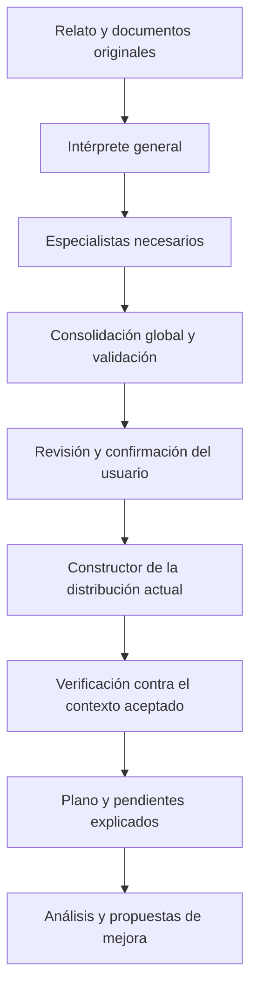

# Plan de `feature/data1`: contexto inicial y reporte de ingeniería

## Continuación del flujo maestro (21 de octubre de 2026)

- Continuación autorizada hacia `Eduardoaot/ProyectoIA3d:feature/experimentoData2-IA` mediante pull request desde `bdiazsofttek-oss:feature/data1`. Lectura implementada en `8bfdb24`: ciclos de 1000 caracteres configurables, paginación de dudas/entregas, memoria auxiliar limitada y presupuesto estimado que reserva la respuesta. Los originales completos, offsets y entregas permanecen conservados.
- Construcción incremental: recinto, lotes de áreas/equipos y recorridos, y comprobación final; cada lote guarda un avance recuperable. Un incumplimiento detiene el siguiente lote; un cambio de maestro invalida la reutilización; un cambio concurrente del expediente impide aplicar un resultado tardío. La interfaz usa los trabajos de construcción y consulta su avance. Se mantiene abierta la evaluación de calidad con Ollama real.
- Verificación de esta continuación: 137 pruebas de backend y 61 de frontend aprobadas, compilación de producción correcta y lint sin errores (advertencias anteriores). Incluye cien equipos distribuidos entre ciclos, conservación de las 120 actividades, interrupción/reanudación del plano, detención por solapes y protección de cambios concurrentes. Chrome comprobó el recorrido HTTP conectado, las actividades/operadores y la construcción por lotes con expediente temporal y proveedor simulado.
- Actualización de GitHub: se incorporaron `eduardo/feature/experimentoData1` (`c935be0`) y el cambio compartido por `feature/experimentoData2-IA`/`feature/experimentoMergeData1Zona2_1` (`f9c4e55`, nuevo juego de espera). Los merges `c190e04` y `2714132` conservaron el commit local `1e3ec19` sin conflictos. Se revisó el recorrido de agentes en código y se precisaron sus responsabilidades reales en [CONTRATO-MAESTRO.md](coordinacion/CONTRATO-MAESTRO.md). Tras integrar: 28 pruebas del maestro/constructor y 59 de frontend aprobadas, compilación correcta; Ollama continuó desconectado.
- Los archivos aportados por el usuario se respaldaron primero en `1341c82`. La integración pendiente de Eduardo y el caso de referencia se publicaron después en `e720563`.
- El flujo aprobado y las responsabilidades están en [CONTRATO-MAESTRO.md](coordinacion/CONTRATO-MAESTRO.md). Incluye comunicación intérprete/especialistas, dudas inciertas, consolidador explícito, construcción verificable y análisis desde el plano aprobado.
- Se implementa el maestro de esquema 2 con entidades, afirmaciones atómicas, evidencia y fuentes completas; la reclasificación del consolidador se aplica al resultado y se persiste. Los trabajos de contexto coordinan etapas y ya no descartan el maestro ni publican un resultado vacío como lectura correcta.
- Referencia de evaluación: [contexto-transformadores.expected.json](pruebas/contexto-transformadores.expected.json). Prioridad general al texto; para este caso, el usuario indicó que las imágenes son más fieles a lo existente y a su ubicación. Sus anotaciones visuales se identifican como revisión humana, no como interpretación de un modelo de visión.
- Las pruebas con proveedor simulado verifican el recorrido y las invariantes. La calidad real de interpretación continúa pendiente de configurar Ollama local; no hay proveedor activo en esta PC durante esta implementación.
- Commits publicados por paso: `4affadb` (intérprete, especialistas y consolidador persistente) y `b523744` (construcción, verificación del plano e interfaz de revisión). La preparación del ensayo real se registra por separado; no cierra la evaluación de fidelidad.
- El constructor ya consume el maestro aceptado sin otra extracción del relato. Requiere ancho/fondo explícitos, conserva cantidades, relaciones y retornos, y devuelve una comprobación por requisito. Las huellas o ubicaciones ilustrativas se declaran como supuestos y no obtienen estado «verificado».
- La interfaz separa las etapas y los datos de la revisión anterior. «Organizar el contexto primero» conduce a la interpretación/revisión; después se construye y se puede volver a comprobar el plano editado. Cambiar datos manuales o prioridad de fuentes exige integrar de nuevo esas entradas. El análisis requiere confirmación del plano y la opción compacta recibe también el contexto aceptado y sus objetivos.
- Si las imágenes son la referencia principal, se requiere una lectura de visión o que el usuario indique explícitamente que contrastó sus datos con ellas. Los modelos sin visión no pasan a considerarse capaces de leer imágenes.
- Los reintentos reutilizan entregas válidas con la misma entrada, modelo y ventana de contexto; un cambio de fuente invalida esa reutilización. `CAUCE_CONTEXT_CONCURRENCY` controla la concurrencia (1–4) y `CAUCE_OLLAMA_CONTEXT` la ventana solicitada a Ollama (8192 por defecto). Las entregas que exceden el presupuesto se señalan, sin recortar su texto silenciosamente.
- Fase 6: herramienta de ensayo real en `backend/evaluate_master.py`, con registros de fuentes, respuestas, tiempos y discrepancias en `.cauce-data/master-evaluation.json`. La ejecución de esta PC quedó como **`not_run`**, por proveedor no disponible; no demuestra calidad de interpretación. El ensayo real y la revisión de fidelidad del caso completo siguen abiertos.
- Validación del código: 130 pruebas de backend y 59 de frontend aprobadas, compilación de producción correcta y recorrido de navegador conectado/compatible comprobado con proveedor de pruebas. Estos resultados verifican el funcionamiento del flujo, no la interpretación del caso real por Ollama.


## Objetivo

Dar al usuario un solo lugar, al inicio del proyecto, para contar cómo funciona su planta, adjuntar evidencia y comprobar qué entendió el sistema antes de analizar. Reunir allí las opciones que hoy están dispersas entre «Datos de la planta», «Referencias con imagen» y «Qué pesa más para ti». Ampliar el reporte con entregables de estudio del trabajo, especialmente cuando el usuario no subió uno.

## Integración de GitHub y punto de continuación (20 de octubre de 2026)

La rama de continuación es **`feature/data1`**, creada en el repositorio de `bdiazsofttek-oss` desde `feature/data` (`d2da671`). Se revisaron y actualizaron los remotos `origin` y `eduardo` antes de integrar:

- **`eduardo/feature/experimentoData1` (`925bfcf`):** su contenido coincide exactamente con el commit `696e841` ya incorporado. Se integra su historial y se resuelven los 14 conflictos conservando los avances DATA posteriores, incluidos expedientes, documentos, operadores y estudios.
- **`eduardo/feature/experimentoMergeData1Zona2_1` (`4f88bad`):** incluida por autorización adicional del usuario. Aporta lectura de recinto, portones y especificaciones, revisión del flujo con un segundo agente, mejoras de áreas/pasillos y elementos fijos, editor y presentación del rediseño, diálogos, cursograma gráfico y arranque local. Sus siete archivos en conflicto se combinan con el backend DATA conectado.
- **Criterios de la combinación:** conservar las rutas y capacidades DATA, los límites de salida del organizador, la entrada de contexto aceptado y los entregables del reporte. Mantener «Sí, confirmar esta versión» antes de analizar y la edición de prioridades en el contexto, con interruptor y pesos base al desactivarlas. El ranking de Eduardo conserva sus detalles; cambiar prioridades requiere revisar y recalcular por el mismo recorrido.
- **Estudios en el reporte:** las actividades aceptadas conservan los entregables estructurados y su procedencia. Cuando todavía no hay actividades aceptadas, el cursograma gráfico derivado del plano se presenta como borrador inferido, sin atribuirle observaciones ni una secuencia única de un proceso ramificado.
- **Proveedor acordado:** Ollama local; el usuario configurará el modelo después. `iniciar.ps1` reutiliza el entorno `.venv` existente y no descarga modelos automáticamente; la descarga queda disponible mediante `-DescargarModelo`.

Verificación de esta integración: **102 pruebas del backend y 57 del frontend aprobadas**, compilación de producción y comprobaciones en Chrome del panel compatible y del flujo HTTP conectado con proveedor simulado (120 actividades, operadores, revisión, confirmaciones, proyectos y vistas móviles). La reducción del número de pruebas del frontend corresponde a funciones retiradas en la rama de Eduardo, como el importador anterior. La interpretación con Ollama real sigue pendiente de configurar el modelo; estas pruebas no la sustituyen.

### Próximo trabajo en esta rama

1. Configurar Ollama local y ensayar textos y documentos reales, registrando calidad, duración y errores de interpretación; verificar también la revisión de flujo añadida por Eduardo.
2. Revisar juntos la experiencia combinada: contexto, construcción del plano, edición, rediseño y reporte. Corregir discrepancias observadas sin perder datos aceptados ni propuestas manuales.
3. Continuar con las extensiones todavía pendientes: definición de eficiencia individual, otros tipos de estudios y formatos, y el diagrama interactivo previo al plano. Requieren cerrar las decisiones de cada apartado antes de implementar sus cálculos o navegación.

El estado operativo de la conexión se describe a continuación. Las secciones del prototipo y de acuerdos anteriores se conservan como historial; no significan que haya que reiniciar D0–D8.

## Primera entrega: validar el frontend

**Actualización de implementación del 20 de octubre:** el usuario autorizó continuar con el backend. Se implementó la extensión [CONTRATO-DATA.md](coordinacion/CONTRATO-DATA.md): expedientes persistentes con revisiones, confirmación masiva, trabajos por bloques con cancelación/reintento, originales y lectores de documentos, importación de operadores, cobertura y entregables estructurados. Las descripciones del prototipo y de las ideas pendientes que siguen son el registro histórico; consultar el estado operativo siguiente para distinguir lo que ya funciona.

### Estado operativo de la conexión DATA

- SQLite conserva cada expediente, sus revisiones y originales en `CAUCE_DATA_DIR` (por defecto `.cauce-data`). La pantalla ofrece guardar/recuperar una copia y exportar/restaurar un paquete con archivos. No hay sincronización automática entre computadoras; se puede trasladar el paquete.
- La ruta compatible `/api/context/organize` se conserva. La interfaz nueva usa trabajos `/api/workspaces/{id}/jobs` para texto largo, muestra progreso y errores, permite cancelar y reintentar bloques. Un resultado no se aplica sobre una revisión cambiada. Si un documento excede el límite de lectura, no se utiliza su vista parcial como si fuera completo.
- Los especialistas de contexto existentes alimentan un consolidador; el servicio acepta únicamente propuestas con respaldo y aplica la confirmación en código. «Confirmar todos los datos» no incorpora conflictos bloqueados; estos permanecen corregibles.
- Estudios tiene entrada de texto completo y filas editables, confirmación masiva y coordinación por tipos: cursograma analítico, hoja de tiempos y mapa de proceso. Los tipos desconocidos se declaran sin determinar. Los promedios de observaciones aportadas se calculan en código; no se generan tiempos normales/estándar sin definición y datos suficientes.
- Documentos de hasta 10 MB: TXT/MD/CSV, XLSX y PDF con texto. Los escaneados y formatos sin lector quedan pendientes. Las referencias visuales conservan el proveedor de visión existente. La exportación puede trasladar originales anteriores de IndexedDB si todavía existen en el navegador.
- Personal permite importar CSV/XLSX y revisar operadores/asignaciones. Eficiencia reportada y valoración de ritmo conservan valor, escala y fuente por separado. Eficiencia individual calculada sigue como «sin datos» mientras no se definan sus observaciones y fórmula; no modifica el factor global del motor.
- Preguntas útiles se integran dentro de revisión, sin añadir otra sección. Las respuestas son información proporcionada por el usuario. Prioridades apagadas usa los pesos base del motor; la respuesta conserva los pesos efectivos.
- El constructor acepta contexto revisado de forma aditiva a `/api/story`; el boceto resultante requiere verificación de dimensiones/posiciones. El análisis y el reporte reciben actividades/operadores aceptados. Los entregables conservan ramas, retornos y valores desconocidos.
- El cursograma propuesto solo se habilita cuando existen actividades vinculadas a rutas del rediseño con distancias calculadas. Las operaciones conservan su fuente de origen y los tiempos de transporte propuestos requieren validación. Un plano sin estudio produce un borrador identificado como tal, no un estudio observado.
- Se mantienen pendientes por diseño: otros tipos de estudios, la definición del desempeño individual y el diagrama interactivo previo al plano. La calidad de interpretación con un modelo real requiere configurar un proveedor activo; las pruebas automatizadas usan proveedores simulados, sin presentarlas como validación del modelo.

Las fases D0–D8 que figuran más abajo sirven como desglose y criterios de extensión de esta conexión. Las decisiones de almacenamiento, prioridades apagadas, catálogo inicial y ubicación de preguntas se concretaron en `CONTRATO-DATA.md` al autorizar esta implementación.

Verificación de la conexión: suite general del backend, pruebas específicas de expedientes/documentos/estudios, 62 pruebas del frontend y compilación. Chrome comprobó tanto la compatibilidad anterior como el flujo HTTP conectado con proveedor simulado, incluyendo 120 actividades, importación de operadores, confirmación masiva y vistas móviles. No hay proveedor Ollama activo en esta PC al cerrar esta entrega; la prueba de calidad con un modelo real queda pendiente de su configuración.

Por indicación del usuario, primero se construye una interfaz navegable para revisar la experiencia. El contrato definitivo, la estructura del backend y los entregables del reporte se trabajarán después de esta revisión.

El prototipo reúne texto libre, diez temas, datos con historial, documentos, estudios manuales, imágenes, prioridades y confirmación del plano/contexto. El acceso está en la esquina superior derecha desde todos los pasos. Rediseño conserva el resumen de prioridades y enlaza a su edición en contexto.

Alcance y límites de esta entrega:

- «Organizar información» clasifica fragmentos por palabras clave en el navegador y lo indica en pantalla. No usa IA ni extrae cifras inferidas. Las propuestas requieren confirmación y conservan su fragmento original.
- Los datos confirmados usan los segmentos existentes. El borrador adicional se guarda en `project.contextWorkspace`, fuera del contrato de planta y de las peticiones a la API. Los proyectos anteriores siguen abriendo sin cambiar su formato.
- Los documentos originales se conservan en IndexedDB en este navegador, hasta 10 MB por archivo. TXT, MD y CSV permiten revisar hasta 100 000 caracteres de texto; los demás formatos quedan pendientes de lectura. La extracción local no verifica hechos. Los adjuntos no se sincronizan con un servidor ni viajan en la exportación actual del proyecto.
- Las imágenes conservan la función anterior y su límite de 1 MB. Solo se marcan interpretadas tras una respuesta del proveedor de visión existente.
- Estudios permite registrar actividades y vincularlas a estaciones/rutas. Tiempo y distancia desconocidos quedan vacíos. La visualización es un borrador del orden capturado; las ramas, uniones y cursogramas finales siguen pendientes.
- La confirmación contempla plano completo, texto, contexto, prioridades y borrador. Un cambio marca los resultados anteriores pendientes de actualizar. No se recalcula automáticamente.

Para revisar: `cd frontend`, `npm ci`, `npm run dev`; abrir el enlace local y entrar en **Ver contexto de la planta**. Se puede recorrer y capturar contexto sin servidor. La creación asistida de planos y el análisis conservan sus servicios actuales.

Verificación de esta entrega: 58 pruebas unitarias, compilación y prueba en Chrome con el caso de transformadores, API simulada y perfil aislado. Se comprobaron propuestas, historial, archivos TXT/PDF, estudios, prioridades, confirmación, persistencia tras recarga, foco de teclado y seis vistas a 390 px. La prueba de navegador se ejecuta con Vite activo mediante `node tests/context-workspace.browser.mjs`; `CAUCE_BROWSER` permite indicar otro Chromium. El lint conserva advertencias previas del proyecto.

## Avance mínimo posterior: captura simple y borrador multiagente

- La captura manual de cada tema pide solo **«¿De qué se trata?»** y **«Descripción»**. Los ejemplos incorporan cantidad, unidad, procedencia y responsable cuando corresponden. Se conservan los metadatos históricos, pero la interfaz ya no obliga a llenarlos como campos separados.
- Las actividades de estudios aparecen como filas verticales compactas. Al abrir una fila se editan tipo, descripción, tiempo, distancia y vínculos; los datos desconocidos continúan vacíos.
- `POST /api/context/organize` consulta un especialista de IA por cada uno de los diez temas y luego un consolidador. Devuelve propuestas con fragmento literal del texto y un **JSON maestro en estado `draft`**. El consolidador solo puede referir propuestas producidas por especialistas; los datos inventados sin fragmento literal se descartan. Los fallos parciales se informan.
- El frontend usa esa ruta cuando el backend anuncia `context_agents`. Si no hay proveedor listo o el backend es anterior, conserva la clasificación local por palabras clave e indica esa limitación. Las propuestas requieren confirmación humana; el JSON maestro se puede consultar en «Así entendimos tu planta» y no modifica el plano.
- Este avance **no sustituye D0–D8**: el JSON maestro todavía no es una versión aceptada y persistida en backend, no se ha conectado con el constructor del plano, ni se han generado cursogramas finales. El límite inicial de esta ruta es de 8000 caracteres por envío; el procesamiento recuperable de documentos largos sigue en D3–D4.

## Gestión local de proyectos y contexto

- **Mis proyectos** permite crear y abrir varios proyectos en el mismo navegador. Cada uno conserva por separado relato, plano, análisis, contexto segmentado, propuestas, estudios, referencias, prioridades y confirmaciones.
- El primer inicio copia el proyecto previo de `cauce-proyecto-v3` (o la migración v2) a `cauce-proyectos-v1` sin borrar las claves anteriores. La colección es la fuente de verdad; `cauce-proyecto-v3` queda como copia compatible del proyecto activo.
- **Borrar contexto de este proyecto** requiere confirmación. Elimina texto, entradas, propuestas, estudios, referencias, prioridades y los originales de sus adjuntos en IndexedDB; conserva el plano y los otros proyectos. El análisis anterior queda marcado como pendiente de actualizar.
- Esta gestión sigue siendo **local al navegador**: no sincroniza proyectos ni adjuntos entre computadoras. La persistencia y exportación completas en servidor continúan en D0–D3.

## Revisión con el usuario: acuerdos e ideas pendientes (20 de octubre de 2026)

Esta sección registra la conversación posterior a la revisión del prototipo. Distingue requisitos acordados de propuestas técnicas que todavía deben cerrarse. Lo descrito como próximo trabajo **no está implementado**. La solicitud de esta revisión es actualizar el plan, sin comenzar cambios de código.

### Acordado para las siguientes entregas

- **La IA interpreta y organiza la información.** El usuario puede describir toda su operación de una vez; no tiene que repartir el relato entre diez formularios. Una misma descripción puede aportar información a varios temas.
- **Confirmación por lote.** Añadir **«Confirmar todos los datos»** para revisar e incorporar propuestas en conjunto, conservando edición y confirmación individual. Entender el relato no garantiza que represente correctamente la operación; confirmar significa aceptar una interpretación, no certificar una medición. Las ambigüedades deben quedar visibles.
- **Captura cotidiana y breve.** Dejar como campos principales **«¿De qué se trata?»** y **«Descripción»**. Usar ejemplos que inviten a mencionar unidades, procedencia, aproximación y persona responsable, sin exigir esos campos por separado al inicio. Aplicar esta entrada a los diez temas, conservando sus herramientas particulares para archivos, imágenes y estudios.
- **Conservar procedencia sin cargar de trabajo al usuario.** Extraer metadatos cuando el relato los aporte; si falta información, conservarla como desconocida. La IA no puede afirmar que una cifra está medida o comprobada por haberla interpretado. Los detalles pueden consultarse y corregirse de forma secundaria.
- **Prioridades activables.** Permitir encender o apagar las prioridades de decisión. Falta definir exactamente el criterio de comparación que se utilizará al apagarlas; no presentar como implementada una eliminación del puntaje multicriterio actual.
- **Mantener «Sí, confirmar esta versión».** El usuario acepta la protección de revisión del contexto/plano. Aclarar qué confirma, cuándo se habilita y por qué está deshabilitado. En el prototipo requiere que exista un plano; evitar un botón deshabilitado sin explicación.
- **Especialistas y consolidador compartido.** Adoptar la separación entre interpretar por especialidad y consolidar un contexto maestro coherente. No se fija una cantidad rígida de dos agentes por tema ni veinte ejecuciones obligatorias por entrada.
- **Estudios por carga masiva.** Pegar texto plano de un proceso o adjuntar un estudio completo, organizarlo y mostrar sus actividades en filas/cuadros editables. El caso objetivo incluye procesos con más de cien actividades. Agregar actividad por actividad sigue disponible como alternativa, sin ser el recorrido principal.
- **Base de operadores.** Incorporar la carga de una tabla con nombre de operador, estación o área, máquina, turno y eficiencia y/o valoración de ritmo, para vincular personas con su operación y consultar datos específicos. Las métricas calculadas y los datos necesarios para sustentarlas deben definirse antes de implementarlas.
- **Dos preguntas rectoras.** El contexto debe servir para explicar cómo está distribuida y funciona la planta actualmente, y qué podría mejorarse con los datos y restricciones disponibles. Diferenciar siempre situación actual, objetivo del usuario y propuesta del sistema.

Ejemplo orientativo para el campo Descripción:

> El corte tarda aproximadamente 12 minutos por pieza. Laura, supervisora del turno de mañana, tomó el tiempo durante la última semana. El equipo está junto a recepción y no puede moverse por su instalación eléctrica.

Este ejemplo contiene tiempo, procedencia, persona, turno, ubicación y restricción. El sistema puede relacionarlos sin pedir que el usuario repita la misma historia en varios temas.

### Ideas propuestas, todavía sin decisión final

| Idea | Intención | Qué falta decidir |
|---|---|---|
| Coordinador de estudios y especialista por tipo | Identificar qué estudios recibió el sistema, qué puede entregar y cómo interpretar cada uno | Catálogo inicial, límites de cada especialista y separación entre interpretar un estudio recibido y producir uno nuevo |
| Preguntas útiles para entender la planta | Pedir únicamente la información que realmente falta | Una sección debajo de prioridades, un bloque dentro de «Así entendimos» o un chat guiado; evitar multiplicar secciones |
| Diagrama previo al plano, parecido a Mermaid | Revisar operaciones, materiales, ramas y uniones antes de dibujar el espacio | Entrega futura después de conectar esta parte; biblioteca, formato e interacción pendientes |
| Confirmación de contexto antes del plano | Aceptar la información organizada y después revisar el plano construido | Si habrá dos momentos explícitos o si basta confirmación de datos más la confirmación actual; no dar por aprobado un cambio de esta secuencia |
| Eficiencia individual y valoración de ritmo | Consultar desempeño con significado y fuentes claras | Definiciones, período, unidades, observaciones necesarias y qué cifras son importadas frente a calculadas |
| Prioridades apagadas | Hacer opcional el ajuste por parte del usuario | Usar pesos base visibles o un criterio base distinto; acordarlo antes de alterar la recomendación |

### Cómo evaluar los diez temas

Los diez temas se conservan provisionalmente como navegación comprensible. No son diez compartimentos exclusivos ni una garantía de suficiencia. Comprobar la cobertura de estas necesidades en el contexto consolidado:

| Necesidad | Información que debe conocerse o quedar marcada como faltante | Temas relacionados |
|---|---|---|
| Producto y demanda | Productos/materiales, cantidades, lotes, frecuencia y objetivos | Negocio, Operaciones, Flujo |
| Proceso real | Actividades, entradas/salidas, variantes, ramas, uniones y retornos | Operaciones, Estudios, Flujo |
| Recursos | Equipos, cantidades, unidades paralelas y asignaciones de personas | Máquinas, Personal |
| Distribución actual | Dimensiones, posiciones o relaciones espaciales, accesos, pasillos, muros y servicios | Máquinas y espacio, Restricciones, Imágenes |
| Funcionamiento | Tiempos, turnos, transportes, esperas, calidad y fuentes | Tiempos, Personal, Calidad, Estudios |
| Mejora viable | Problemas observados, metas, elementos fijos y límites de inversión/cambio | Negocio, Restricciones, Prioridades |

Un orden de operaciones no determina las posiciones físicas de las máquinas. Si solo se conoce el proceso, el sistema debe decir que falta reconstruir la distribución actual. No presentar un acomodo sugerido como si fuera el plano observado.

Las preguntas de seguimiento deben derivarse de esta cobertura: por ejemplo, preguntar por la posición del horno si se conoce su existencia pero no su ubicación. No volver a preguntar lo ya respondido en un documento ni obligar a completar todos los temas para trabajar con un alcance limitado.

## Experiencia propuesta

1. En la esquina superior derecha del paso inicial: botón **«Ver contexto de la planta»**, visible también en pasos posteriores para consultar o corregir. Abre una página o panel de ancho completo con navegación lateral, parecido en organización a `/docs` del backend. La interfaz debe mostrar ejemplos y lenguaje cotidiano, no exigir claves técnicas como `pulido.t_ciclo`.
2. Portada **«Cuéntanos sobre tu planta»**: cuadro de texto libre y botón **«Organizar información»**. La IA propone datos estructurados por tema con fragmento de origen y estado. Ofrecer edición, confirmación individual y **«Confirmar todos los datos»**; los metadatos se consultan en un detalle secundario. El texto original se conserva. Si no hay IA disponible, siguen funcionando la captura manual y los archivos.
3. Temas: **Negocio**, **Operaciones**, **Tiempos**, **Máquinas y espacio**, **Flujo de materiales**, **Personal**, **Calidad**, **Restricciones**, **Estudios del trabajo** y **Imágenes y layouts**. Cada tema muestra un resumen legible, datos vigentes, archivos asociados y «Agregar / corregir». La captura principal pide solo «¿De qué se trata?» y «Descripción», con ejemplos orientativos. Mantener historial, fuente, fecha y nivel de confianza del contexto actual sin exigir su llenado separado al inicio.
4. En cada tema: adjuntar documentos de contexto. Registrar nombre, tipo, fecha, origen y tema. Extraer texto solo de formatos realmente soportados; mostrar «adjunto, pendiente de lectura» para lo demás. Las imágenes y planos van en su tema, con nota del usuario; únicamente afirmar «interpretada» cuando un proveedor con visión la haya leído. Los archivos nunca deben confundirse con hechos verificados.
5. **Estudios del trabajo**: pegar un texto completo o adjuntar cursogramas analíticos y sinópticos, diagramas de recorrido, hojas de tiempos, métodos y otros estudios. Organizar procesos de más de cien actividades en filas/cuadros editables, con tipo (operación, transporte, inspección, espera, almacenamiento), relaciones de precedencia, tiempo, distancia y fuente. Vincular operaciones a estaciones/rutas y dejar vacío lo desconocido. La captura individual es opcional.
6. **Prioridades de decisión**: mover «Qué pesa más para ti» a este lugar, con explicación breve, interruptor y valores iniciales visibles. El usuario puede activarlas, ajustarlas o volver a ellas antes de recalcular. La vista de rediseño muestra estado, resumen y enlace. La semántica del modo apagado está pendiente de decisión.
7. **«Así entendimos tu planta»**: resumen por tema, datos faltantes, contradicciones y supuestos, con enlaces para corregir. Antes del análisis, confirmar una versión concreta del contexto y del plano. Si cualquiera cambia, avisar que el análisis/reporte anterior requiere actualización. Conservar la protección de `Context2` y explicar cualquier requisito que impida confirmar.

## Flujo y reporte

- El recorrido principal queda: **Proceso y plano → Planta 3D → Diagnóstico → Rediseño → Reporte → Resumen**. Contexto es una entrada transversal desde el primer paso; desaparecen las tarjetas separadas de datos e imágenes. El usuario puede regresar a contexto desde cualquier paso.
- El modelo de flujo debe admitir **una estación con varias salidas** y **varias entradas a una estación**, así como retornos. Cada arco lleva origen, destino, producto/material, frecuencia o cantidad, lote y, si se conoce, tiempo y distancia. No deducir una única secuencia lineal si el proceso converge o diverge.
- El reporte agrega **cursograma analítico actual** y, cuando hay rediseño sustentado, **cursograma propuesto**; **cursograma sinóptico o mapa de proceso** cuando los datos alcancen; tabla de tiempos y recorridos; supuestos, fuentes, datos faltantes y recomendaciones concretas. En flujos ramificados, mostrar ramas y uniones sin inventar orden total.
- Si el usuario subió un estudio, usarlo como fuente revisable y citarlo; si no, generar un **borrador derivado del plano y las rutas**. Cada renglón indica si procede de un documento, una medición, el modelo de planta o una inferencia. Tiempo/distancia desconocidos se muestran como «sin dato»; nunca como cero. El reporte no debe llamarlo estudio cronometrado si no hubo medición.

## Plan de desarrollo del backend y conexión con el frontend

Esta secuencia sustituye el orden inicial de cinco pasos: la interfaz ya se prototipó primero por petición del usuario. Es un plan de implementación, no una declaración de funcionalidades existentes. Los nombres de rutas, campos y módulos nuevos son propuestas que se concretan en D0. No modificar `coordinacion/CONTRATO-v3.md` con esta actualización; documentar su extensión compatible por separado antes de tocar el código.

### Punto de partida comprobado en el repositorio

- `backend/main.py` ya ofrece `/api/story`, `/api/analyze`, `/api/report`, `/api/chat`, `/api/plan/ops`, `/api/references/read` y `/api/capabilities`, entre otras rutas. `/api/story` recibe texto y crea una planta; no recibe todavía el contexto maestro confirmado.
- `backend/cauce/context.py` conoce nueve segmentos, acepta texto o contexto segmentado y conserva las entradas vigentes con historial. Todavía no incorpora estudios, documentos, propuestas ni una base individual de operadores.
- `backend/cauce/providers/base.py`, `providers/__init__.py` y `agents/roles.py` aportan la interfaz y configuración por rol. `agents/spatial.py` ya separa lecturas de edificio, zonas, acomodo y paredes. Reutilizar estas piezas.
- `versions.py` ya calcula versiones canónicas de planta y contexto. El análisis recibe contexto y registra su versión; esto no significa que traduzca automáticamente los datos del contexto a parámetros de cálculo del motor.
- La eficiencia de `params` usada por `engine.py` es un factor global de tiempo disponible. No representa una base individual ni una valoración de ritmo por operador.
- El frontend conserva propuestas, adjuntos y actividades en `project.contextWorkspace`; su organización por palabras clave y los archivos IndexedDB todavía no tienen una conexión equivalente en backend.

### Arquitectura propuesta

Recorrido de datos:

```text
Texto completo / documentos / tabla de operadores
  → ingreso, extracción y fuentes originales
  → selección de especialistas pertinentes
  → propuestas de contexto y actividades con evidencia
  → consolidador compartido + validaciones de código
  → revisión y confirmación individual o por lote
  → versión aceptada del contexto maestro
  → propuesta de plano actual + verificación espacial
  → confirmación del plano
  → cálculo del motor + estudios y reporte sustentados
```

Responsabilidades:

| Pieza | Responsabilidad | Límite |
|---|---|---|
| Orquestador | Seleccionar especialistas y coordinar su ejecución | Ejecutar solo los necesarios; respetar límites del proveedor y registrar fallos parciales |
| Especialistas de contexto | Interpretar procesos, recursos, espacio, personas u otras áreas pertinentes | Proponer datos con referencias, sin escribir directamente sobre la versión aceptada |
| Coordinador de estudios, si se aprueba | Identificar estudios recibidos y entregables posibles, con datos necesarios | Distinguir documento recibido, estudio interpretado, borrador generado y estudio no sustentable |
| Especialistas de estudios, catálogo por definir | Interpretar o estructurar el tipo de estudio correspondiente | Usar un esquema específico; no inventar tiempos ni tratar una inferencia como observación |
| Consolidador compartido | Resolver identidades y duplicados; reunir aportes y detectar incompatibilidades | No elegir silenciosamente entre afirmaciones contradictorias ni sobrescribir correcciones del usuario |
| Validadores y repositorio | Validar esquemas, unidades y referencias; aplicar cambios versionados | Solo el código guarda cambios válidos y confirmados de forma atómica |
| Constructor/verificador del plano | Usar contexto aceptado y lectura espacial existente para proponer la situación actual | No confundir secuencia de actividades con posiciones; respetar elementos fijos y trabajo manual |
| Motor y entregables | Calcular métricas y construir tablas/diagramas trazables | La IA interpreta y redacta; los cálculos y verificaciones numéricas se realizan en código |

El JSON maestro es una representación consolidada del contexto; no exige que varios agentes editen concurrentemente un mismo archivo. Cada ejecución devuelve propuestas y el servicio aplica los cambios validados contra una revisión concreta.

### D0 — Cerrar contrato, estados y decisiones de implementación

**Entregable:** extensión de contrato y ejemplos de peticiones/respuestas para frontend y backend, sin romper los clientes anteriores.

- Separar contexto original, propuestas, datos aceptados, actividades, documentos, operadores, preguntas abiertas, preferencias y referencias al plano. Mantener el formato de planta v3; si se necesita modificarlo, justificar y probar una migración antes.
- Definir versión propia del contexto maestro, identificadores estables y referencias a fragmentos, páginas, filas o actividades de origen. Un dato podrá relacionarse con varios temas sin duplicar su identidad.
- Definir estado de revisión y procedencia por separado. Propuesta, aceptado, descartado, ambiguo y sustituido no equivalen a medido, estimado, inferido o desconocido. La confianza de interpretación tampoco certifica exactitud de la medición.
- Acordar representación de valores ausentes, unidades, rangos y contradicciones. No sustituir faltantes por cero ni inventar un intervalo para expresar baja confianza.
- Definir semántica del interruptor de prioridades; preservar `weights_used` real del análisis y registrar su versión. No confundir desactivar ajustes personales con desactivar automáticamente todo criterio de comparación.
- Resolver almacenamiento local del servicio: proyectos, originales y revisiones persistentes; evaluar SQLite más archivos frente a almacenamiento en archivos. Definir exportación/restauración del conjunto y límites configurables. La elección queda pendiente de esta fase.
- Definir trabajos largos: estado, progreso, resultado parcial, cancelación y recuperación tras fallo/reinicio. No resolver un proceso de cien actividades con una petición opaca que pueda truncarse.
- Añadir capacidades solo cuando la funcionalidad correspondiente exista. Los nombres nuevos se acuerdan aquí; conservar el comportamiento del backend anterior cuando no se anuncien.

**Verificación:** fixtures de proyecto anterior y del prototipo, migración reversible por copia, roundtrip sin perder historial/imágenes/actividades y ejemplos explícitos de conflicto y faltante.

### D1 — Servicio de contexto maestro, revisiones y revisión por lote

**Entregable:** poder leer/guardar un proyecto y aceptar propuestas sin depender aún de IA.

- Crear modelos y servicios separados del enrutamiento de `main.py`. Organización sugerida: `schemas/context_workspace.py`, `services/context_workspace.py`, `repositories/projects.py` y `routers/context_workspace.py`, ajustando los nombres al contrato aprobado.
- Reutilizar `context.py` y `versions.py` mediante adaptadores compatibles. No repartir la misma lógica de entradas vigentes entre varios módulos.
- Incorporar el borrador frontend al contexto maestro mediante migración explícita. Los originales IndexedDB solo se transferirán cuando el usuario active su carga; un metadato sin binario seguirá indicando que el original falta en el servidor.
- Registrar confirmación individual y **«Confirmar todos los datos»** contra revisión e identificadores concretos. Idempotencia para reintentos y comprobación de revisión esperada: una confirmación de una vista antigua no acepta propuestas nuevas.
- El botón masivo acepta las propuestas revisables del conjunto mostrado; los conflictos o errores estructurales quedan aparte con explicación. Definir esta excepción en el contrato y hacer visible el resultado del lote.
- Conservar originales, versiones anteriores, decisiones de descarte y correcciones; impedir que una organización posterior resucite datos descartados o sustituya datos corregidos sin revisión.

**Conexión:** reducir captura a los dos campos acordados, detalle opcional de metadatos y acción masiva. Mantener captura local cuando la capacidad nueva no exista.

**Verificación:** confirmación repetida, edición concurrente, lote parcialmente bloqueado, importación del proyecto anterior y persistencia tras reiniciar el servicio.

### D2 — Interpretación asistida y consolidación de texto completo

**Entregable:** «Organizar información» conectado a IA real con resultados revisables.

- Crear orquestador, esquemas y prompts por especialidad usando la interfaz de proveedores actual. Un rol no implica un modelo distinto ni un servicio siempre activo. Seleccionar especialistas según el contenido, con concurrencia limitada y tiempos máximos.
- Conservar el relato completo y segmentarlo respetando identificadores y referencias. Compartir un índice de entidades para que dos especialistas no inventen operadores o estaciones distintos con el mismo nombre.
- Consolidar unidades, entidades y afirmaciones equivalentes sin alterar su evidencia. Situación actual, objetivo y propuesta permanecen separados; las contradicciones generan preguntas, no una elección oculta de la IA.
- Devolver propuestas, vínculos a fragmentos originales, dudas, cobertura y fallos de especialistas. Validar cada salida contra esquema y límites antes de mostrarla o guardarla como propuesta.
- Mantener guardado manual y reintento de la parte fallida si el proveedor no está disponible. No presentar la clasificación local por palabras clave como interpretación completa de IA.

**Conexión:** cargar propuestas en la vista existente; permitir corregir, confirmar individualmente o por lote y conservar originales.

**Verificación:** texto que aporta a varios temas, cuatro hornos instalados/dos operando, negaciones, cambios del usuario, referencias ambiguas y proveedor falso con respuestas inválidas o fallos parciales.

### D3 — Documentos de contexto y extracción real

**Entregable:** evidencia documental recuperable y procesable por el mismo recorrido de propuestas.

- Servicio de ingreso/descarga con metadatos, tamaño, tipo comprobado, identificador/hash y estados de extracción independientes de la confirmación de datos.
- Empezar por TXT/MD/CSV; elegir después lectores de PDF con texto y XLSX según muestras reales y dependencias justificadas. Un archivo escaneado necesita OCR o visión; los formatos no soportados quedan pendientes, sin simular lectura.
- Conservar referencias a páginas/filas/fragmentos y mostrar cualquier límite o truncamiento. Procesar documentos largos por partes recuperables, sin dar por leído lo que no se procesó.
- Mantener el flujo de visión existente y anunciar su disponibilidad real; una imagen adjunta no es una imagen interpretada.
- Añadir exportación/restauración de originales junto con el contexto o un manifiesto que indique los archivos faltantes. Respetar originales que todavía existan solo en el navegador.

**Verificación:** texto extraíble, PDF sin texto, archivo no soportado, tipo inválido, límite excedido, duplicado y restauración en un entorno limpio.

### D4 — Estudios por texto masivo y tabla de actividades

**Entregable:** pegar un proceso largo y revisar sus actividades en una tabla editable, con evidencia y vínculos.

- Cerrar el catálogo inicial de estudios. Propuesta de primer alcance: cursograma analítico y hoja de tiempos; diagramas sinópticos/de recorrido según información disponible. Otros estudios y sus especialistas se incorporan posteriormente por registro, sin prometerlos antes de implementarlos.
- Si se aprueba el coordinador, devolver un inventario: estudio recibido, tipo identificado o desconocido, especialista aplicable, entregable posible y datos que faltan. Un documento puede contener varios estudios.
- Organizar texto o documento completo en actividades con identificador, descripción, tipo, relaciones de precedencia, estación/ruta, producto/material y fuentes. Secuencia de captura no equivale a orden total cuando hay ramas o uniones.
- Conservar observaciones de tiempos, unidades, repeticiones y distancia cuando existan. Faltantes quedan nulos; los agregados numéricos los calcula código después de validar su base.
- Procesar más de cien actividades por bloques con resumen común, identificadores estables y reconciliación de relaciones entre bloques. Informar cuántas actividades/partes se procesaron y cuáles faltan; no devolver un estudio aparentemente completo tras una truncación.
- Presentar tabla por filas/cuadros, edición puntual y confirmación masiva; permitir agregar una actividad y reorganizar el texto sin perder correcciones aceptadas. Una actividad no crea automáticamente una nueva estación física.

**Verificación:** fixture de al menos 120 actividades con ramas, reunión, retorno, tiempos desconocidos y fuentes múltiples; ninguna actividad perdida/duplicada por fronteras entre bloques; edición y reintento sin sobrescribir correcciones.

### D5 — Base de operadores y métricas sustentadas

**Entregable:** importar, revisar y vincular operadores; incorporar únicamente los cálculos cuya definición ya esté acordada.

- Entrada inicial propuesta: CSV con previsualización y mapeo de columnas; XLSX queda sujeto al lector elegido en D3. Conservar fila original y errores por fila; el nombre no es una identidad única, admitir identificador de operador.
- Modelo propuesto: operador, área/estación, máquina o unidad concreta, turno, período de vigencia y valor aportado. Separar ficha de persona, asignaciones y observaciones: una persona puede cambiar de máquina/turno o atender varias unidades.
- Separar eficiencia reportada, valoración de ritmo y eficiencia calculada. Registrar definición, escala, período y fuente del indicador; no convertir `0.85`, `85` o una escala de ritmo sin confirmar su significado.
- Una tabla de asignaciones más un porcentaje no basta para calcular una eficiencia independiente. Definir qué mediciones/producción, tiempo observado o estándar, calidad y período requiere cada indicador; mostrar «sin datos» cuando falte su base.
- Mantener el factor global `params.efficiency` como concepto distinto. Antes de que nuevos indicadores afecten capacidad o tiempos, especificar qué tiempo es manual, qué tiempo es automático y cómo evitar descontar dos veces un mismo factor.
- Consultar resultados por persona/asignación y período comparable; mostrar cobertura y método. La IA explica resultados del motor, sin atribuir causas no observadas a una persona.

**Verificación:** homónimos, turnos múltiples, reasignaciones, indicadores con escalas diferentes, faltantes y caso numérico de referencia para cada fórmula aprobada antes de implementarla.

### D6 — Cobertura, preguntas útiles y revisión comprensible

**Entregable:** ayudar a completar lo necesario sin crear un formulario obligatorio de diez apartados.

- Evaluar cobertura de proceso, recursos, espacio, funcionamiento y mejora; separar requisitos bloqueantes para una operación de información opcional para enriquecerla.
- Generar preguntas concretas sobre faltantes/contradicciones, con tema, motivo y referencias. Priorizar las que permitan reconstruir la distribución actual o evaluar una mejora.
- Las respuestas alimentan el mismo recorrido de propuestas y consolidación; permitir «No lo sé», posponer y consultar la fuente. No repetir preguntas ya resueltas ni tratar un chat como escritura directa de hechos.
- Elegir ubicación con el usuario: bloque en revisión, sección debajo de prioridades o chat. La recomendación de diseño es reutilizar un espacio existente antes de ampliar la navegación; sigue siendo una propuesta.
- Explicar por qué «Sí, confirmar esta versión» no está disponible y ofrecer la acción que falta. Mantener la confirmación del plano antes del análisis; cualquier separación adicional de confirmaciones se decide explícitamente.

**Verificación:** relato completo sin preguntas redundantes, plano sin medidas, ubicación ambigua, falta opcional no bloqueante y pregunta respondida desde un documento previo.

### D7 — Contexto aceptado hacia plano y análisis existentes

**Entregable:** recorrido integrado de datos aceptados a plano revisable y resultados versionados.

- Añadir una entrada compatible a la construcción de planta que reciba la revisión aceptada del contexto y sus vínculos, conservando `/api/story` para los clientes anteriores.
- Reutilizar `story.py`, especialistas espaciales y validaciones geométricas actuales. No construir una historia resumida que pierda cantidades, unidades, ramas, restricciones o evidencia.
- Adaptar de forma explícita los campos confirmados a la planta/parámetros que realmente consume el motor; validar unidades, significado y revisión. Datos textuales de contexto no pasan a modificar cálculos por aparecer en el JSON maestro.
- No inventar dimensiones/posiciones observadas. Si hace falta una hipótesis para un boceto, identificarla, pedir aceptación y conservar su carácter supuesto. No reemplazar el plano manual por una nueva extracción sin acción del usuario.
- Conservar ramas, uniones y retornos en datos y editor. Probar frecuencias/lotes por arco sin convertir un grafo en una lista única ni contar repetidamente el mismo flujo.
- Registrar revisiones de contexto aceptado, planta, prioridades, operadores/estudios usados y métodos. Un cambio relevante marca análisis y reporte desactualizados; navegar o abrir un detalle no los invalida ni recalcula.
- Aplicar la semántica acordada del interruptor de prioridades e informar siempre el criterio y los pesos efectivamente utilizados.

**Verificación:** recorrido completo con transformadores y fixture ramificado; elemento fijo intacto, rediseño manual conservado, confirmación antigua rechazada y regresiones de capacidad/distancia sin cambio no justificado.

### D8 — Estudios entregables, reporte y cierre de integración

**Entregable:** estudios y reporte consistentes con las fuentes y el cálculo, con lista explícita de qué se entrega y qué falta.

- Construir tablas de actividades, tiempos y recorridos desde revisiones aceptadas y resultados del motor; conservar ramas/uniones en los entregables que las admitan. No presentar el borrador secuencial del prototipo como estudio final.
- Distinguir estudio recibido, estudio interpretado y borrador generado. Si no hubo medición, no llamarlo estudio cronometrado. Si existe estudio previo, citarlo y mostrar discrepancias, sin sustituirlo silenciosamente.
- Añadir esquemas para cada entregable implementado y un resumen de disponibilidad: generado, parcial o pendiente de datos, con razón. El rediseño solo produce un estudio propuesto cuando sus datos lo sustentan.
- Extender `facts()` y la validación de informe con los valores autorizados, revisiones y referencias nuevas. La redacción usa estos hechos; las cifras y agregados salen de código.
- Completar exportación/importación y avisos de resultados desactualizados. Verificar frontend nuevo con backend anterior y cliente anterior con backend nuevo.
- Cerrar documentación, pruebas de regresión y pruebas de navegador con IA simulada; realizar después un ensayo con el proveedor real y registrar sus límites de calidad/tiempo, sin confundir mocks con validación de interpretación real.

**Verificación:** reporte sin archivo previo, estudio aportado con discrepancia, tiempos desconocidos conservados, cifras no sustentadas rechazadas y expediente exportado/restaurado con sus referencias.

### Cortes de entrega y criterio de avance

- **D0–D2:** primera conexión útil del contexto: entrada breve, IA, propuestas, edición y confirmación masiva.
- **D3–D4:** documentos y estudios largos sin captura actividad por actividad.
- **D5–D6:** operadores con semántica acordada y preguntas dirigidas para mejorar cobertura.
- **D7–D8:** contexto aceptado integrado con plano, análisis y estudios/reporte.

Cada fase incluye su conexión mínima al frontend y pruebas correspondientes; no dejar toda la integración para el final. Mantener un commit y push por fase terminada y verificada, sin mezclar trabajo incompleto con una fase declarada lista. En cambios del motor, escribir primero el caso que falla y conservar las regresiones F0–F9 y `test_regresion_5_4.py`.

La visualización interactiva previa al plano, parecida a Mermaid, queda para una entrega posterior. En esta secuencia sí se conserva la estructura de grafo necesaria para no perder ramas y uniones.

### Decisiones que deben resolverse antes de la fase afectada

1. **D0/D7:** ¿apagar prioridades usa los pesos base actuales o un criterio de comparación diferente?
2. **D0/D3:** almacenamiento persistente del servicio y formatos adicionales prioritarios, con una muestra real para cada lector.
3. **D4:** aprobar coordinador/registro de especialistas y catálogo inicial de estudios; determinar qué estudios recibidos o entregados son prioritarios.
4. **D5:** significado y escala de la eficiencia/valoración de ritmo existentes, fórmula de las métricas calculadas y datos disponibles para sustentarlas.
5. **D6:** ubicación de preguntas útiles y si se desea separar un momento de confirmación del contexto previo a la construcción del plano.

Estas dudas no bloquean esta actualización documental. Deben aclararse cuando se prepare la fase correspondiente; no asumir que una propuesta técnica equivale a una decisión del usuario.

## Criterios de aceptación

- Un usuario nuevo puede pegar una descripción de planta, revisar lo interpretado, corregir un dato y analizar sin escribir claves técnicas.
- Cada tema permite añadir y revisar su evidencia; se distingue claramente «archivo subido», «texto extraído», «imagen interpretada» y «dato confirmado».
- La estructura de contexto conserva historial y procedencia; un proyecto guardado antes de esta rama sigue abriendo.
- Un ejemplo con bifurcación y reunión de rutas aparece correctamente en editor, análisis y reporte.
- El reporte produce un cursograma analítico útil sin archivo previo y deja en blanco los tiempos no medidos. Si hay estudio previo, cita su fuente y señala discrepancias.
- Al cambiar contexto, prioridades o plano después de analizar, el usuario ve qué resultado debe recalcular.
- «Confirmar todos los datos» acepta un lote revisable sin incorporar conflictos ocultos ni requerir cien confirmaciones individuales.
- La captura principal pide título y descripción; unidades y procedencia explícitas se conservan sin exigir un formulario extenso.
- Un texto de al menos 120 actividades se organiza en filas editables, conserva su evidencia y no pierde ramas, retornos ni correcciones aceptadas al reprocesarlo.
- La importación de operadores distingue valores reportados de cálculos y no confunde eficiencia global, eficiencia individual y valoración de ritmo.
- Las preguntas pendientes responden a faltantes reales y la desactivación de prioridades tiene un comportamiento acordado y visible.

## Prompt para retomar en casa

> Trabaja en `feature/data1` de ProyectoIA3d. Lee primero la integración y el estado operativo de `PLAN-DATA.md`, `coordinacion/CONTRATO-DATA.md`, `coordinacion/CONTRATO-v3.md` y `CRITERIOS-IMPLEMENTACION-1.1.md`. El backend D0–D8 y su conexión inicial ya están implementados; esta rama también integra las dos ramas Data1 de Eduardo indicadas arriba. No reinicies el prototipo ni sustituyas los avances de un lado por los del otro. El proveedor acordado es Ollama local y el usuario configurará el modelo después; el siguiente ensayo debe usar fuentes reales y distinguir la calidad del modelo de las pruebas con proveedor simulado. Mantén la confirmación del contexto/plano, las prioridades activables con pesos base al apagarlas, los proyectos y originales persistentes, las actividades aceptadas con evidencia, los valores desconocidos y las ramas/uniones. Revisa con el usuario los resultados combinados antes de ampliar alcance. Siguen pendientes las definiciones de eficiencia individual, más especialistas/formatos y el diagrama interactivo previo al plano; no inventes sus fórmulas ni presentes un borrador derivado del plano como estudio observado. Conserva commit y push por fase terminada y verificada.


#### ULTIMO PLAN

Lo resolvería alrededor de **un contexto maestro compartido, verificable y versionado**. Ese contexto debe alimentar tanto la explicación al usuario como la construcción del plano.

Los diez temas seguirían como navegación. Los especialistas trabajarían sobre una misma interpretación de la planta y conservarían relaciones entre temas.



Lo desarrollaría en seis fases, cada una con un resultado comprobable y su commit correspondiente.

1. **Establecer un caso real de referencia.**

   Primero usaríamos el relato que te produjo resultados incorrectos. Anotaríamos qué debe entender: máquinas, cantidades, actividades, conexiones, ubicaciones, medidas y elementos fijos.

   También señalaríamos qué información realmente falta. Así podremos distinguir una interpretación equivocada de una distribución que el texto no permite determinar.

   **Criterio de cierre:** tener una lista concreta con la que evaluar contexto y plano.

2. **Construir una representación común de la planta.**

   El intérprete general identificaría entidades y relaciones. Por ejemplo:

   > Horno H1 → está en Acabado → ocupa el fondo derecho → está junto a Pintura → no se puede mover.

   Cada afirmación conservaría su fuente y fragmento original. La explicación podría reformularse de manera clara, mientras cantidades, unidades y relaciones permanecerían vinculadas a su evidencia.

   El maestro distinguiría **situación actual, objetivos, información desconocida y supuestos propuestos**. Las correcciones aceptadas tendrían prioridad y conservarían historial.

   **Criterio de cierre:** poder explicar cómo funciona y cómo está distribuida la planta sin perder información explícita.

3. **Corregir la coordinación de especialistas y la consolidación.**

   Usaría una primera lectura general para detectar qué especialidades necesitan intervenir. Los especialistas recibirían las entidades relevantes, sus fuentes y las dudas pendientes.

   Después habría una **consolidación global obligatoria** que realmente pueda reclasificar, relacionar, eliminar duplicados y señalar contradicciones. Su resultado se guardaría y sería el mismo que ve el usuario.

   Para documentos largos, dividiríamos por unidades comprensibles —apartados, actividades o tablas—, conservando referencias entre fragmentos y una revisión conjunta final.

   **Criterio de cierre:** que una corrección del consolidador aparezca efectivamente en pantalla y en el maestro utilizado después.

4. **Hacer que la interfaz represente correctamente el estado del trabajo.**

   Mostraríamos etapas comprensibles: leyendo, interpretando, contrastando información y preparando la revisión. Las propuestas anteriores quedarían identificadas como una versión previa.

   Un fallo de IA tendría un resultado explícito. La clasificación por palabras clave seguiría siendo una alternativa identificada como tal. “Terminado” indicaría también si el resultado está completo, parcial o requiere aclaraciones.

   **Criterio de cierre:** que puedas saber qué terminó, qué falló y qué información estás revisando.

5. **Reconstruir el plano desde el contexto aceptado.**

   El constructor consumiría directamente entidades, medidas y relaciones del maestro. El relato original seguiría disponible como evidencia.

   La IA interpretaría restricciones como “al fondo”, “junto a” o “separado por un muro”; el código convertiría esas restricciones en posiciones y comprobaría geometría.

   Después, un verificador compararía el plano con los requisitos:

   - ¿Están todas las máquinas y cantidades?
   - ¿Se respetaron ubicaciones, cercanías y elementos fijos?
   - ¿Coinciden medidas, accesos y conexiones del proceso?
   - ¿Qué requisito quedó incumplido o no se pudo comprobar?

   **Criterio de cierre:** cada requisito explícito debe estar cumplido o tener una explicación visible. La distribución actual y las mejoras propuestas permanecerían diferenciadas.

6. **Validar con IA real y después optimizar tiempos.**

   Probaríamos el caso original y variantes con otras palabras, procesos ramificados y datos incompletos. Conservaríamos entradas, respuestas y tiempos para localizar dónde aparece cada error.

   Después ajustaríamos concurrencia, reutilización de resultados y consultas por especialista según el equipo disponible.

**El primer entregable sería tu relato correctamente organizado y explicado en el contexto maestro.** El segundo sería reconstruir su distribución y demostrar, requisito por requisito, qué respetó el plano. Esa sería la base para dar por resuelto el flujo.

EJEMPLO COTIDIANO:
Entre el Interprete general y los especialistas necesarios deberian de poder comunicarse bien
Al consolidar deberia de haber un consolidador
Supongamos en un ejemplo seria como si
Un cliente pide un proyecto al vendedor
El vendedor (interprete general) le dice a los especialistas que deben de hacer y si los especialistas tienen dudas el Interprete deberia intentar resolverlas o mantener la duda como incierta
Despues de ello todos trbajan en hacer su parte
Y cuando todos acaban un consolidador va preguntando de uno por uno que es lo que tienen y lo va colocando en una plantilla en orden para que cuando lo entregue al que fabricara el proyecto o pieza lo haga lo mas rapido y correctamente posible, asimismo el que se encarga de mejorar la pieza también sabra que hacer
Luego el Consolidador se lo pasa al constructor o fabricador y el se encarga de crearlo, lo cual es tal cual lo que el cliente pidio
Y despues de entregarselo al cliente seeria como si el cliente lo revisa y aprueba para que despues le hagan unas mejoras, lo cual vuelve a pasar el pdoructo o proyecto pero ahora solo lo manda a la compañia del proyecto, la cual lo redirige directamente con el especialista en Analisis y optimisación, el cual realiza pruebas con la pieza actual y con el Consolidado maestro y con la pieza entregada por el cliente vuelve a intentar optimizarlo
Despues de ello con la ayuda de su asistente lo construyten juntos para que el resultado sea el mejor


Ya quedaron separados y subidos a `feature/data1`:

- `4affadb`: intérprete, especialistas y consolidador.
- `b523744`: construcción desde el maestro aprobado y verificación del plano.
- `fa6db18`: herramienta de evaluación real y plan actualizado.

Pasaron **130 pruebas del backend**, **59 del frontend** y la compilación. El repositorio quedó limpio y sincronizado.

Sigue pendiente comprobar la fidelidad con el caso real cuando Ollama esté activo; quedó documentado en `PLAN-DATA.md`.
